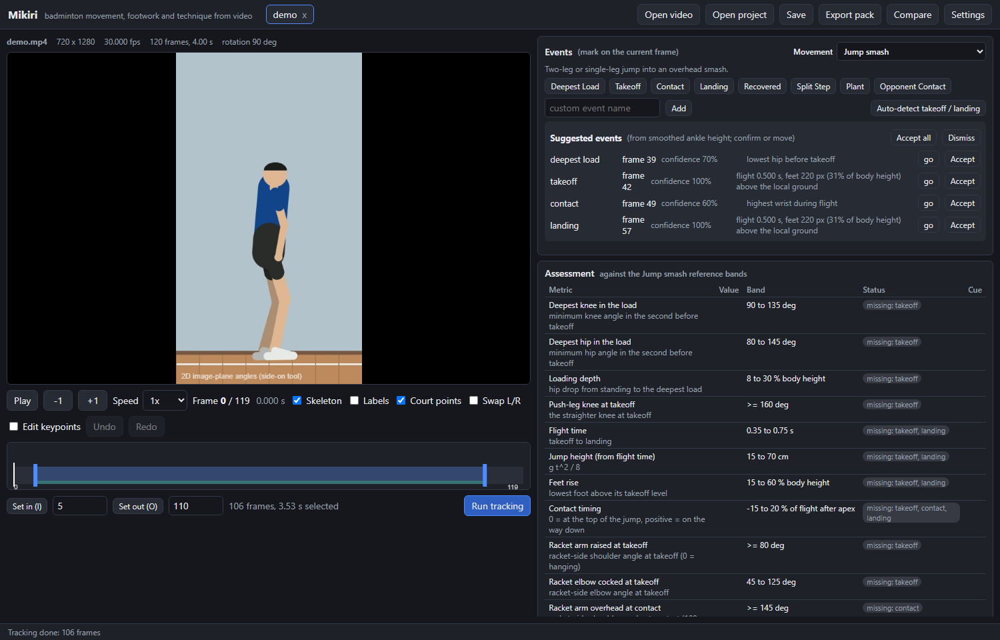
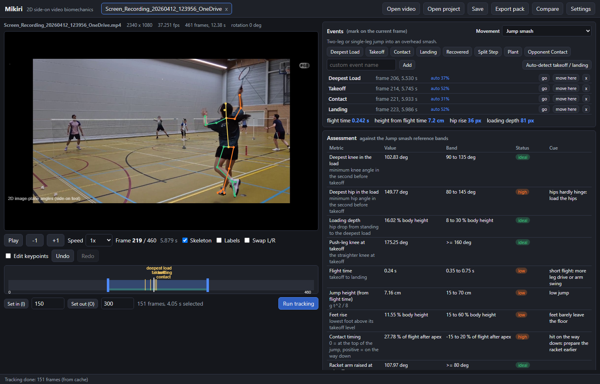
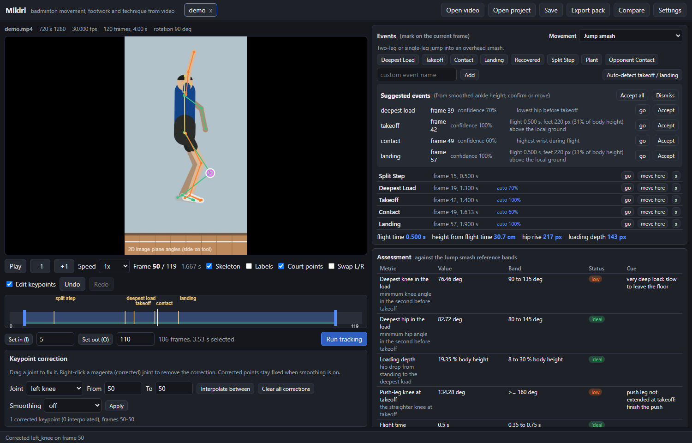
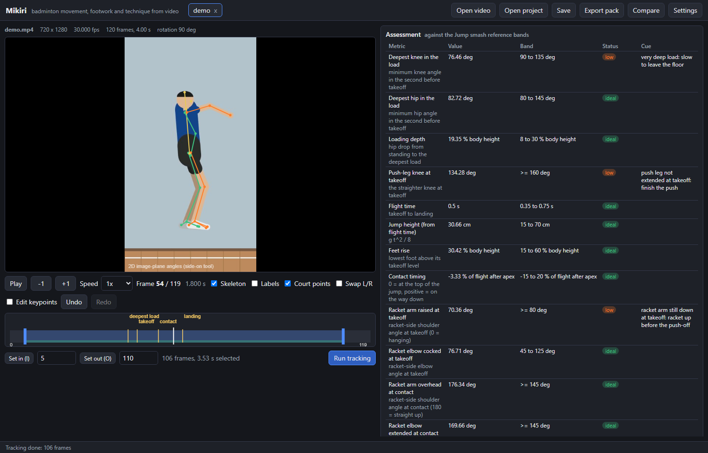
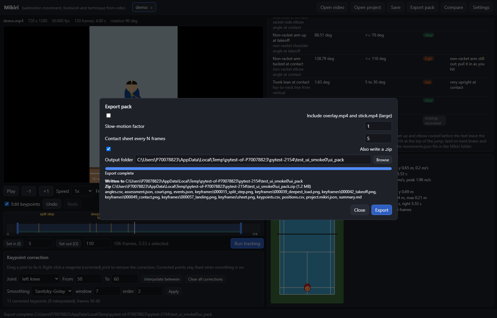
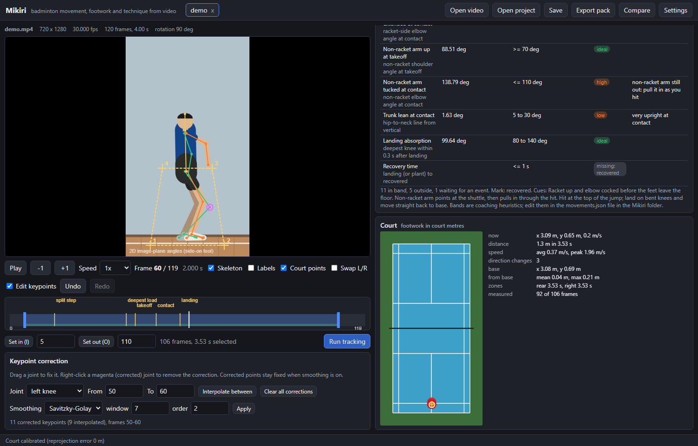
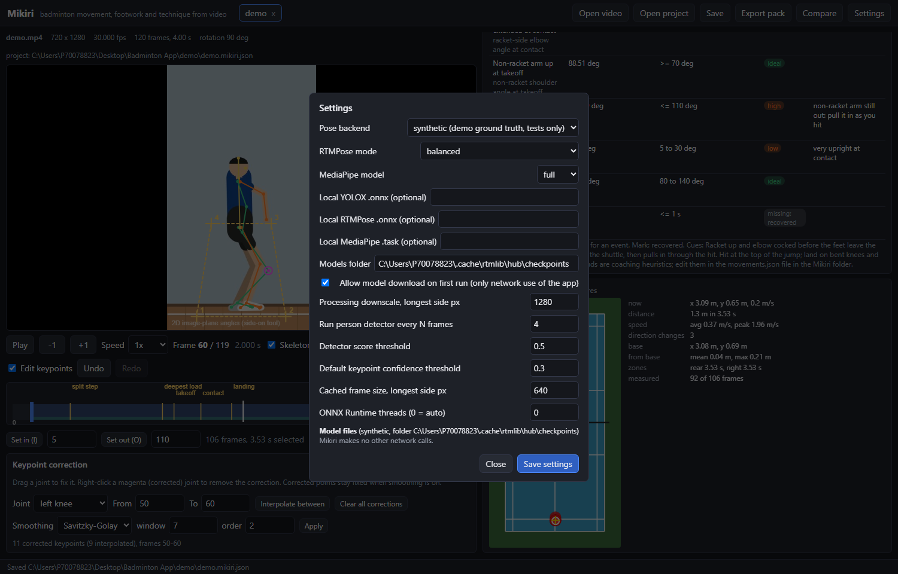

# Mikiri

Mikiri (見切り, "reading the shuttle") is a local video analysis app for badminton, formerly JumpLab. Today it covers jumps, lunges, split steps and recovery; footwork, racket and shuttle tracking are the next steps (see docs/roadmap.md).

Local video biomechanics for badminton movements. Load a phone clip, track the
athlete with RTMPose on the CPU, scrub frame by frame with a skeleton overlay,
read joint angles over time, mark takeoff and landing (or let Mikiri suggest
them), fix bad keypoints by dragging them, and export a self-describing pack
you can hand to a person or an AI assistant. No cloud, no telemetry; the only
network access is the one-off model download.

Mikiri is a **single-camera 2D tool**: it measures angles in the image plane
from a side-on view. See "Limitations" before trusting a number.



## 60 second quick start

Requirements: Python 3.11 or newer on Windows, macOS or Linux. ffmpeg is
bundled (via `imageio-ffmpeg`), nothing else to install.

```bash
pip install -e .
```

```bash
mikiri
```

The browser opens at `http://127.0.0.1:8765`. Then:

1. **Open video**: browse, paste a path, or upload. Duration, fps and resolution
   appear above the frame; rotation metadata is respected.
2. **Trim**: drag the blue handles on the timeline or press <kbd>I</kbd> /
   <kbd>O</kbd> on the current frame.
3. **Run tracking**: click the athlete in the first frame (or "Track largest
   person"). The first run downloads the models (about 150 MB) and tells you
   where from. Progress bar and Cancel are in the dialog.
4. **Scrub**: <kbd>Left</kbd>/<kbd>Right</kbd> one frame,
   <kbd>Shift</kbd>+arrows ten frames, <kbd>Space</kbd> play/pause at 0.1x to
   1x. Click any plot or the timeline to jump.
5. **Events**: press a preset (split step, deepest load, takeoff, contact,
   landing, recovered) to mark the current frame, or "Auto-detect takeoff /
   landing" and accept the suggestions. Flight time appears immediately.
6. **Fix keypoints**: tick "Edit keypoints" (<kbd>E</kbd>), drag a joint,
   optionally "Interpolate between" two corrected frames, undo with
   <kbd>Ctrl</kbd>+<kbd>Z</kbd>.
7. **Export pack**: choose whether to include the videos, then find the
   folder and zip in the dialog. **Save** (<kbd>Ctrl</kbd>+<kbd>S</kbd>)
   writes `<video>.mikiri.json` next to the clip; opening the clip again
   restores everything.

The `demo/` folder holds three clips: `demo.mp4` is a synthetic jump used by
the tests (`mikiri make-demo` regenerates it), `20260611_220344.mp4` is a
2 minute phone recording of jump smashes filmed from behind-diagonal, and
`Screen_Recording_20260412_123956_OneDrive.mp4` is a screen recording of a
match seen from behind. Both real clips contain other players: use the
"Track largest person" default or click the athlete in the Run dialog, and
expect to flip "Swap L/R" for footage from behind.



## What you get



* Skeleton overlay colour-coded left (green) / right (orange), with a
  "Swap L/R" toggle for clips filmed from behind.
* Plots of knee, hip, elbow, shoulder and ankle angles (left and right),
  trunk lean, segment angles versus the ground, hip height, ankle heights and
  stance width, with a cursor synced to the scrubber and event lines.
* **Movement profiles**: jump smash, scissor-kick smash, block jump, lunge,
  split step and recovery. The profile sets the event buttons, the automatic
  suggestions (flight, hop or lunge detectors) and an **Assessment** table
  that compares the clip's metrics with reference bands and gives a cue when
  a value is outside its band. Bands are coaching heuristics; edit them in
  `movements.json` in the Mikiri folder. See
  [docs/movements.md](docs/movements.md).

  
* Automatic takeoff / landing suggestions from the lowest foot's trajectory
  against a perspective-aware ground model (works when the athlete runs
  towards the camera), with a confidence figure and a list of every other
  airborne phase in the clip; you confirm or move them.
* Keypoint correction with interpolation across a frame range, optional
  Savitzky-Golay or Butterworth smoothing (off by default; corrected points
  stay put), undo/redo.
* Scale calibration from the athlete's height or two clicked points, so hip
  height, loading depth and jump height are also reported in cm.
* Side-by-side comparison of two open projects with scrubbers aligned on an
  event (for example takeoff); the second clip's angles are overlaid dashed.
* Batch mode: `mikiri batch FOLDER` tracks and exports every clip in a folder.



### The export pack

```
<name>/
  angles.csv        one row per frame: frame, time_s, every angle, hip_y, ankle_L_y,
                    ankle_R_y, stance_width, per-angle confidence, corrected/lost flags
  keypoints.csv     all 26 keypoints per frame, pixel coordinates + confidence
  events.json       name, frame, time_s, source, confidence
  keyframes/        PNG overlay at each event frame, plus sheet.png (every Nth frame)
  overlay.mp4       skeleton over the video, H.264 yuv420p (optional)
  stick.mp4         stick figure only (optional)
  summary.md        metadata, event table, angles at each event, flight time,
                    jump height, angle definitions, limitations
  project.mikiri.json  reopen the analysis in Mikiri
<name>.zip          the same, zipped
```

`summary.md` reports the flight time between takeoff and landing, the jump
height implied by it, hip rise and loading depth, and explains every column so
the pack stands on its own. Angle conventions are documented in
[docs/angles.md](docs/angles.md).

## Court calibration and footwork

Click the four court corners you can see (or the near half, or the near
baseline plus the short-service line) once per clip and Mikiri maps the
player's feet onto a top-down court in metres: a court map with the track,
heat map and current position next to the video, footwork metrics (distance,
average and peak speed, direction changes, base position, time per zone),
and `positions.csv` plus `court.png` in the export pack. The camera must be
static. Details and accuracy notes in [docs/footwork.md](docs/footwork.md);
the plan for racket and shuttle tracking is in [docs/roadmap.md](docs/roadmap.md).



## Filming guidelines

* **Side-on.** Put the camera perpendicular to the direction of the jump so
  the knees, hips and trunk move in the image plane. Filming from behind or
  at an angle makes angles meaningless and confuses left and right.
* **Camera at hip to chest height**, on a tripod or leaning on something
  steady, 4 to 5 m back.
* **Headroom above the jump** and the whole body in frame throughout,
  including the feet at the deepest load.
* **120 fps or more** (240 fps if the phone offers it in good light).
  Takeoff and landing are sub-frame events at 30 fps.
* **Good, even light** and a background that contrasts with the athlete.
  Avoid strong backlight and other people crossing behind.
* Keep the original file. WhatsApp and similar re-encode and drop frames;
  Mikiri uses the frame index as its primary key and derives time from the
  measured frame rate, but nothing recovers dropped frames.

## Limitations of single-camera 2D analysis

* An angle is only correct when the joint's plane of motion is parallel to the
  camera sensor. Out-of-plane motion (a rotated trunk, a hip that turns in)
  foreshortens segments and changes the apparent angle; the same jump filmed
  from a slightly different spot gives different numbers.
* There is no depth. Pixel distances only become centimetres through the
  scale calibration, and only in the plane of the athlete.
* Left and right come from the pose model and can be mirrored when the
  athlete faces away or turns; use "Swap L/R" and note the camera side.
* Fast feet blur at 30 to 60 fps; ankle and toe keypoints jitter. The auto
  events use a smoothed signal and hysteresis and report a confidence, but
  you should confirm them on the frames.
* The pose model was trained on people, not on every racket position; hands
  and feet behind the body are the first things it loses. Fix them by hand.
* Results are best used comparatively: the same athlete, filmed the same way,
  over time.

## Settings

Settings (gear button) cover the pose backend (rtmlib RTMPose by default,
MediaPipe PoseLandmarker as an alternative), the RTMPose size
(lightweight / balanced / performance), local model files if you do not want
any download, the processing downscale (default longest side 1280 px, so long
240 fps clips stay fast and are never loaded into RAM at once), how often the
person detector runs, the confidence threshold below which angles are
blanked, and the ONNX Runtime thread count (0 = auto; on CPUs with many
cores the auto value is markedly faster than ONNX Runtime's own default). Settings and caches live in `%LOCALAPPDATA%\Mikiri` (or
`MIKIRI_HOME`).



## Troubleshooting

* **`No Python at '"...\python.exe"'` when running `pip` or `mikiri` inside
  the venv.** The virtual environment's base interpreter moved or is blocked
  (the shipped `.venv` was created by `uv` from a Python living under
  `%APPDATA%\uv`, which some corporate policies refuse to execute). Recreate
  the environment from any normally installed Python 3.11 or newer and
  reinstall:

  ```bash
  rmdir /s /q .venv && py -3.11 -m venv .venv && .venv\Scripts\activate.bat && pip install -e .
  ```

  Replace `py -3.11` with `C:\Python313\python.exe` (or whatever `py -0p`
  lists) if 3.11 is not installed.
* **`OSError: No such file or directory` during `pip install` with a very
  long path.** Windows still limits paths to 260 characters unless long
  paths are enabled; keep the project in a short folder such as
  `C:\Users\<you>\Desktop\Badminton App`.
* **First tracking run is slow or fails to download models.** The two RTMPose
  files (about 150 MB) come from download.openmmlab.com with a Hugging Face
  mirror as fallback; on a machine without internet, download them elsewhere
  and point Settings at the `.onnx` files.

## Command line

```bash
mikiri                       # start the app (default port 8765, opens a browser)
mikiri serve --port 9000 --no-browser --open path/to/clip.mp4
mikiri batch path/to/folder --out path/to/exports --no-videos
mikiri make-demo             # regenerate demo/demo.mp4
```

## Development

```bash
pip install -e .[dev]
python -m playwright install chromium
ruff check src tests
pytest -m "not slow and not ui"      # fast unit tests
pytest -m ui                          # Playwright smoke test (also refreshes the screenshots)
pytest -m slow                        # real RTMPose pipeline on the demo clip and on the real footage (minutes on CPU)
```

`scripts/real_clip_screenshots.py` drives a running server with Playwright on
any clip (trim, click the athlete, accept events, screenshot); it produced the
real-footage screenshot above.

Layout: `src/mikiri` (package), `src/mikiri/server` (FastAPI + static
front end), `tests`, `docs`, `demo`. Every non-obvious choice is written up in
[DECISIONS.md](DECISIONS.md).
